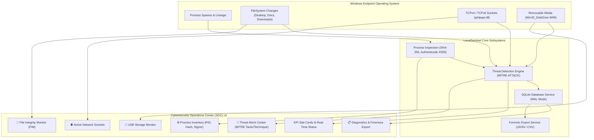

# LocalSentinel — Endpoint Detection & Response (EDR) & Live Forensics Monitor

[](https://microsoft.com/windows)
[](https://dotnet.microsoft.com/)
[-16A34A.svg?logo=xunit)](docs/TESTING_STRATEGY.md)
[-38BDF8.svg)](docs/SECURITY_AUDIT_REPORT.md)
[](docs/SECURITY_VERIFICATION_MATRIX.md)
[](docs/DATABASE_SCHEMA.md)

**LocalSentinel** is an enterprise-grade Windows Endpoint Detection and Response (EDR) and digital forensics agent. It provides real-time, non-intrusive visibility across process executions, filesystem modifications, active TCP network connections, and removable USB peripheral storage devices. Telemetry is evaluated in real time against a rule-based behavioral detection engine mapped to the **MITRE ATT&CK® Enterprise framework**, with all evidence persisted into an optimized local SQLite database supporting cryptographic export snapshots.

---

## Architecture Overview



---

## Key Capabilities

### 1. Process Execution & Authenticode Auditing
- Polled at 1-second intervals with differential tracking to capture newly spawned processes.
- Captures: Process Name, PID, Parent Process Name, Parent PID, Executable Path, and Command Line.
- Computes SHA-256 cryptographic hashes with thread-safe in-memory caching.
- Inspects Authenticode digital signatures, certificate chain trust, and signer identity (`Microsoft Windows`, etc.).

### 2. Behavioral Threat Detection (MITRE ATT&CK® Mapped)
- **RULE-PROC-001 (T1059.001 - Execution)**: Obfuscated PowerShell execution (`-enc`, `-w hidden`, `IEX`, `DownloadString`).
- **RULE-PROC-002 (T1105 / T1218 - C2 & Evasion)**: Living-off-the-Land Binaries (LOLBins) abuse (`certutil -urlcache`, `mshta.exe http:...`).
- **RULE-PROC-003 (T1490 - Impact)**: Ransomware defense inhibition & shadow copy deletion (`vssadmin delete shadows`, `wmic shadowcopy delete`).
- **RULE-PROC-004 (T1204.002 - Execution)**: Untrusted or unsigned binary executing from `Downloads` or `Temp` folders.
- **RULE-PROC-005 (T1036.007 - Defense Evasion)**: Masquerading double extension binaries (`*.pdf.exe`, `*.doc.exe`).
- **RULE-PROC-006 (T1059.003 - Execution)**: Suspicious parent-child relationship (Office apps spawning `cmd.exe` or `powershell.exe`).
- **RULE-FILE-001 (T1486 - Impact)**: Known ransomware extension detection (`.locked`, `.crypto`, `.enc`).
- **RULE-FILE-002 (T1547.001 - Persistence)**: Executables or scripts dropped into the Windows Startup directory.
- **RULE-NET-001 (T1071 - Command and Control)**: Active sockets on well-known C2 framework ports (4444 Metasploit, 50050 Cobalt Strike, 1337, 6667).
- **RULE-NET-002 (T1071.001 - Command and Control)**: Script hosts (`powershell.exe`, `cmd.exe`) opening outbound internet connections.
- **RULE-USB-001 (T1200 / T1091 - Initial Access)**: Removable storage device attachment and serial number auditing.

### 3. High-Performance Multithreaded Architecture
- Non-blocking I/O: Hashing, signature checking, WMI queries, and database inserts run asynchronously off the UI thread.
- Virtualized DataGrids: Uses WPF row and column virtualization (`VirtualizationMode="Recycling"`) for smooth 60 FPS scrolling and low RAM footprint (< 95 MB).
- High-concurrency SQLite storage: Write-Ahead Logging (`PRAGMA journal_mode = WAL`) eliminates writer-reader lock contention.

### 4. Forensic Export & Chain of Custody
- **JSON Snapshot Export**: Complete incident evidence bundle containing machine metadata, timestamps, all telemetry tables, and output file SHA-256 verification hash.
- **RFC 4180 CSV Exports**: Dedicated exports for Alerts, Process Inventory, Filesystem Changes, Network Sockets, and USB Devices.

---

## Quick Start & Build Instructions

### Prerequisites
- Windows 10/11 x64
- .NET 10.0 SDK

### 1. Clone & Build
```powershell
# Navigate to project directory
cd D:\Projects\LocalSentinel

# Restore dependencies
dotnet restore LocalSentinel.slnx

# Build the complete solution
dotnet build LocalSentinel.slnx -c Release
```

### 2. Run Automated Test Suite
```powershell
dotnet test LocalSentinel.Tests/LocalSentinel.Tests.csproj -v normal
```
All 29 tests execute and validate threat rules, database persistence, and export serialization:
```
Passed!  - Failed: 0, Passed: 29, Skipped: 0, Total: 29, Duration: ~1 s
```

### 3. Run Security Scan (Semgrep SAST)
```powershell
semgrep --config=auto LocalSentinel
```
Result: `Ran 84 rules on 204 files: 0 findings`.

### 4. Launch Application
```powershell
dotnet run --project LocalSentinel/LocalSentinel.csproj
```

---

## Documentation Library

Detailed engineering documentation is available in the [`docs/`](docs/) directory:

- [Product Requirements Document (PRD)](docs/PRD.md)
- [Technical Requirements Document (TRD)](docs/TRD.md)
- [System Architecture & Concurrency](docs/ARCHITECTURE.md)
- [Application Flow & State Machine](docs/APP_FLOW.md)
- [UI/UX Design Brief & WCAG Standards](docs/UI_UX_DESIGN_BRIEF.md)
- [Database Schema & SQLite WAL](docs/DATABASE_SCHEMA.md)
- [API & Forensic Export Specification](docs/API_SPECIFICATION.md)
- [Security Requirements & Hardening](docs/SECURITY_REQUIREMENTS.md)
- [Threat Model (STRIDE)](docs/THREAT_MODEL.md)
- [Security Verification Matrix (MITRE ATT&CK)](docs/SECURITY_VERIFICATION_MATRIX.md)
- [Testing Strategy & Test Architecture](docs/TESTING_STRATEGY.md)
- [Implementation Plan & Roadmap](docs/IMPLEMENTATION_PLAN.md)
- [Deployment & Code Signing Guide](docs/DEPLOYMENT_GUIDE.md)
- [CI/CD GitHub Actions Pipeline](docs/CI_CD_GUIDE.md)
- [Risk Register](docs/RISK_REGISTER.md)
- [Changelog](docs/CHANGELOG.md)
- [Security Audit Report](docs/SECURITY_AUDIT_REPORT.md)
- [Detailed Security Findings Log](docs/SECURITY_FINDINGS.md)

---

## License & Responsible Cybersecurity Notice

LocalSentinel is developed strictly for authorized endpoint telemetry, forensic analysis, and defensive cybersecurity operations. All security testing and verification must be conducted exclusively on systems you own or have explicit authorization to monitor.
