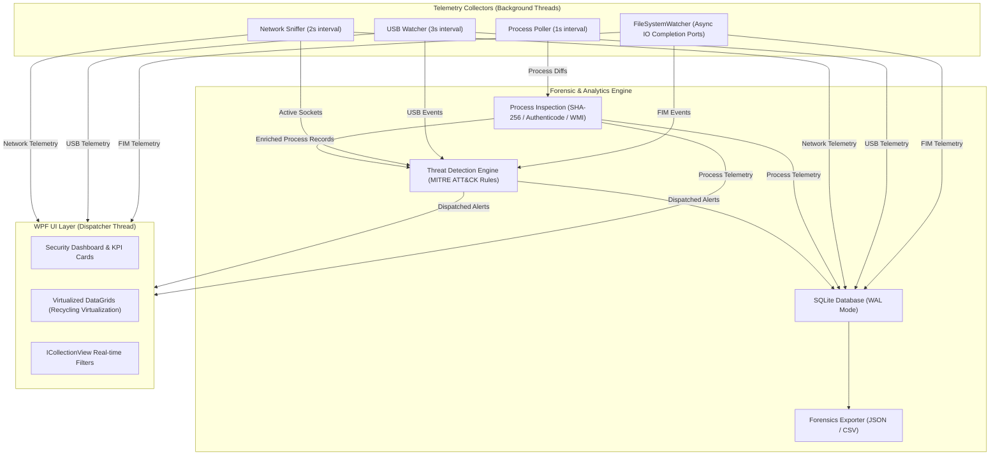

# Architecture & Engineering Design — LocalSentinel EDR v2.0

## 1. System Architecture

LocalSentinel utilizes an asynchronous multi-threaded architecture that completely decouples telemetry capture and forensic analytics from the user interface rendering loop.



## 2. Concurrency & Threading Model

### 2.1 The UI Dispatcher Boundary
In legacy implementations, all process inspection, file hashing, and database writes were executed synchronously on the WPF UI thread (`DispatcherTimer`). This led to UI freezing when computing hashes of large executables or querying WMI.

In LocalSentinel v2.0:
- **Tick Guarding**: Boolean locks (`isProcessTickRunning`, `isNetworkTickRunning`, `isUsbTickRunning`) prevent timer re-entrancy and memory starvation if a system call takes longer than the interval.
- **Asynchronous Inspection**: `Task.Run` offloads cryptographic hashing, X509 certificate parsing, and WMI queries to background thread-pool threads.
- **Batched UI Marshaling**: Filtered results are marshaled back to the UI thread via `Dispatcher.BeginInvoke` or `Dispatcher.Invoke` strictly for presentation updates.
- **Background Database Persistence**: Database write operations are dispatched via background fire-and-forget tasks, ensuring Zero Frame Drops on the UI thread.

## 3. UI Virtualization & Memory Efficiency

WPF `DataGrid` controls nested inside vertical `ScrollViewer` containers lose row virtualization because the outer scrollviewer provides infinite vertical height. This forces WPF to instantiate UI elements for thousands of rows, leading to heavy memory usage and lag.

LocalSentinel resolves this:
1. Replaced the outer scroll container with modern tab-based modular views (`TabControl`).
2. Enabled row and column virtualization on `EvidenceGridStyle`:
   ```xml
   <Setter Property="EnableRowVirtualization" Value="True"/>
   <Setter Property="EnableColumnVirtualization" Value="True"/>
   <Setter Property="VirtualizingPanel.IsVirtualizing" Value="True"/>
   <Setter Property="VirtualizingPanel.VirtualizationMode" Value="Recycling"/>
   <Setter Property="ScrollViewer.CanContentScroll" Value="True"/>
   ```
3. Retains memory footprint below 95 MB RAM even when tracking hundreds of live system entities.
