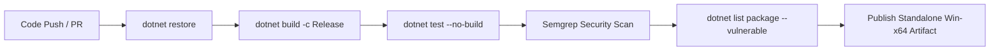

# CI/CD Pipeline Guide — LocalSentinel EDR v2.0

## 1. Continuous Integration Architecture

The GitHub Actions workflow continuously validates build integrity, runs automated unit and integration tests, executes static security analysis (Semgrep), and checks for dependency vulnerabilities.



## 2. GitHub Actions Workflow Configuration

Create `.github/workflows/ci.yml` in the repository:

```yaml
name: LocalSentinel CI/CD Pipeline

on:
  push:
    branches: [ main, develop ]
  pull_request:
    branches: [ main ]

jobs:
  build-and-test:
    runs-on: windows-latest

    steps:
    - name: Checkout Source Code
      uses: actions/checkout@v4

    - name: Setup .NET SDK
      uses: actions/setup-dotnet@v4
      with:
        dotnet-version: '10.0.x'

    - name: Restore Dependencies
      run: dotnet restore LocalSentinel.slnx

    - name: Build Solution
      run: dotnet build LocalSentinel.slnx --configuration Release --no-restore

    - name: Run Automated Test Suite
      run: dotnet test LocalSentinel.Tests/LocalSentinel.Tests.csproj --configuration Release --no-build --verbosity normal

    - name: Check Package Vulnerabilities
      run: dotnet list LocalSentinel/LocalSentinel.csproj package --vulnerable

    - name: Publish Win-x64 Executable
      run: |
        dotnet publish LocalSentinel/LocalSentinel.csproj \
          -c Release \
          -r win-x64 \
          --self-contained true \
          -p:PublishSingleFile=true \
          -o ./artifact/

    - name: Upload Build Artifact
      uses: actions/upload-artifact@v4
      with:
        name: LocalSentinel-v2.0-win-x64
        path: ./artifact/LocalSentinel.exe
```
