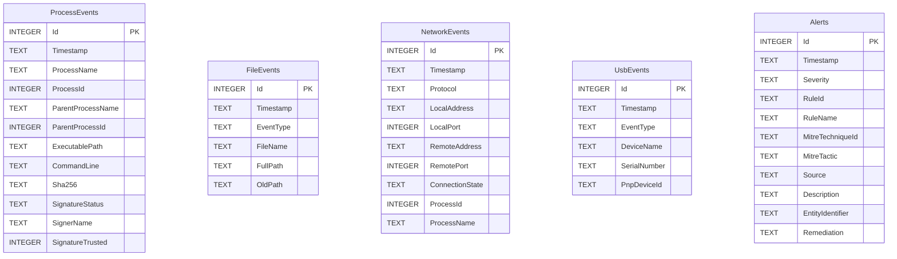

# Database Schema & Storage Architecture — LocalSentinel EDR v2.0

## 1. Storage Overview

LocalSentinel utilizes an embedded SQLite database (`Microsoft.Data.Sqlite`) located at:
`%LOCALAPPDATA%\LocalSentinel\LocalSentinel.db`

### 1.1 Concurrency & Performance (WAL Mode)
Upon initialization, the database service enables Write-Ahead Logging (WAL):
```sql
PRAGMA journal_mode = WAL;
PRAGMA synchronous = NORMAL;
```
- **Benefits**: Readers do not block writers, and writers do not block readers. High-frequency telemetry inserts from background collectors proceed without contention against GUI reader queries.

## 2. Entity-Relationship Model



## 3. Database Indexes

To maintain instant query performance during forensics analysis, indices are established on all temporal columns:
```sql
CREATE INDEX IF NOT EXISTS IX_ProcessEvents_Timestamp ON ProcessEvents(Timestamp);
CREATE INDEX IF NOT EXISTS IX_FileEvents_Timestamp ON FileEvents(Timestamp);
CREATE INDEX IF NOT EXISTS IX_NetworkEvents_Timestamp ON NetworkEvents(Timestamp);
CREATE INDEX IF NOT EXISTS IX_UsbEvents_Timestamp ON UsbEvents(Timestamp);
CREATE INDEX IF NOT EXISTS IX_Alerts_Timestamp ON Alerts(Timestamp);
```

## 4. Retention & Database Maintenance

- **Vacuuming & Purging**: `ClearAllEvents()` executes `DELETE FROM` across all telemetry tables followed by `VACUUM;` to reclaim unused disk pages.
- **Diagnostics API**: `GetMetrics()` computes live row counts and physical database size on disk.
