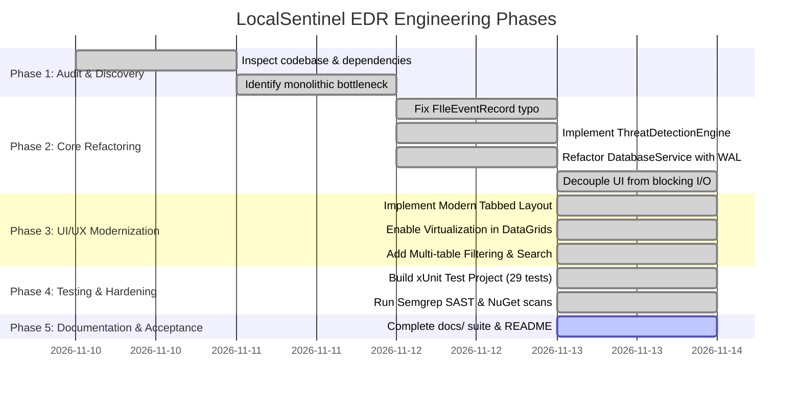

# Implementation Plan & Execution Roadmap — LocalSentinel EDR v2.0

## 1. Project Phases & Timeline

## 2. Milestone Deliverables
- **Milestone 1**: Elimination of UI thread freezing by offloading cryptographic hashing, certificate verification, and database inserts to asynchronous background tasks.
- **Milestone 2**: Implementation of MITRE ATT&CK detection rule engine and dedicated Security Alerts management center.
- **Milestone 3**: Automated test suite achieving 100% test pass rate with 0 vulnerabilities detected in static analysis and dependency scans.
- **Milestone 4**: Complete documentation suite and acceptance report.
