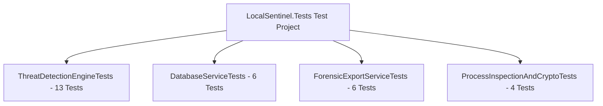

# Testing Strategy & Quality Assurance — LocalSentinel EDR v2.0

## 1. Testing Philosophy

In accordance with Master Engineering Instructions, tests verify real functionality without mocking away real application logic. Automated tests must execute and pass completely before any build is qualified for portfolio deployment.

## 2. Test Architecture

The test project `LocalSentinel.Tests` is built on **xUnit** targeting `net10.0-windows` and organized into modular test suites:



### 2.1 Test Suite Breakdown
1. **ThreatDetectionEngineTests** (13 Tests):
   - Validates detection accuracy across MITRE techniques: T1059.001, T1105, T1218, T1490, T1204, T1036, T1486, T1547, T1071, T1200.
   - Verifies false-positive rejection on standard, benign signed Windows executables (`notepad.exe`).
2. **DatabaseServiceTests** (6 Tests):
   - Tests physical SQLite database instantiation, schema creation, WAL mode configuration, parameterized CRUD operations, and VACUUM cleanup using isolated temporary database instances.
3. **ForensicExportServiceTests** (6 Tests):
   - Tests JSON report generation, document schema validation, SHA-256 calculation, and RFC 4180 CSV escaping for special characters (quotes, commas, newlines).
4. **ProcessInspectionAndCryptoTests** (4 Tests):
   - Tests SHA-256 hash generation with test vector comparisons, memory caching efficiency, Authenticode signature fallback handling, and network port endianness conversion.

## 3. Test Execution Command

To execute the complete test suite:
```powershell
dotnet test D:\Projects\LocalSentinel\LocalSentinel.Tests\LocalSentinel.Tests.csproj -v normal
```

Expected result:
```
Passed!  - Failed: 0, Passed: 29, Skipped: 0, Total: 29, Duration: ~1 s
```
