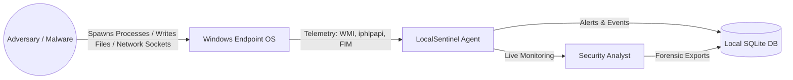

# Threat Model & STRIDE Analysis — LocalSentinel EDR v2.0

## 1. System Overview & Boundaries

LocalSentinel operates on the local Windows endpoint, interacting with the Windows Kernel, File System, Network Stack, and WMI provider.

## 2. STRIDE Threat Analysis

| STRIDE Category | Threat Description | Severity | LocalSentinel Mitigation |
| :--- | :--- | :--- | :--- |
| **Spoofing** | Attacker executes a binary named `svchost.exe` from a user directory to spoof system components. | **High** | `RULE-PROC-004` and `RULE-PROC-005` verify executable paths, digital signatures, and Authenticode trust rather than relying solely on process names. |
| **Tampering** | Rogue process attempts to inject malicious SQL into telemetry logs via process names or command lines. | **High** | Fully parameterized SQL queries (`$processName`, `$commandLine`) and strict literal DDL execution; 0 SQL injection vectors verified by Semgrep. |
| **Repudiation** | User denies plugging an unauthorized USB drive or launching a malicious script. | **Medium** | Cryptographically hashed forensic audit trail recording device PNP IDs, serial numbers, timestamps, and process hashes. |
| **Information Disclosure** | Sensitive memory or document content leaked via telemetry. | **Low** | Data minimization: Only metadata (PID, path, hash, headers) is logged; file payloads and memory contents are not retained. |
| **Denial of Service** | Malicious script rapidly creates millions of files to exhaust disk space and freeze the UI. | **High** | In-memory `ObservableCollection` capped at 250 records; FileSystemWatcher buffers sized appropriately; UI deduplication window (800ms) prevents UI thread freezing. |
| **Elevation of Privilege** | Attacker exploits agent IPC or binary hijacking. | **Medium** | No external IPC listeners or network ports exposed by LocalSentinel. Runs with standard user privileges and utilizes strict assembly resolution. |

## 3. Attack Surface & Evasion Countermeasures

1. **PowerShell Obfuscation (`-enc`, hidden cradles)**: Detected by behavioral regex parsing for `-enc`, `-w hidden`, and `IEX downloadstring` regardless of flag ordering.
2. **Double Extension Masquerading (`.pdf.exe`)**: Explicitly flagged under MITRE T1036.007.
3. **Volume Shadow Deletion (`vssadmin delete shadows`)**: Flagged at Critical severity under MITRE T1490 to detect early ransomware preparation.
