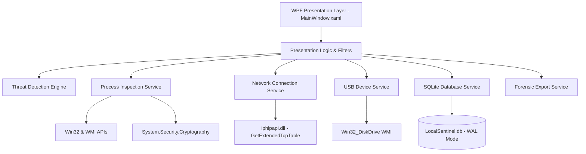

# Technical Requirements Document (TRD) — LocalSentinel EDR v2.0

## 1. Technical Architecture Overview

LocalSentinel is developed in modern C# utilizing the Windows Presentation Foundation (WPF) on the .NET 10 runtime (`net10.0-windows`), designed for execution on 64-bit Windows architectures (x64). It leverages native Windows APIs, Win32 P/Invoke structures, WMI instrumentation, and SQLite for embedded data persistence.



## 2. Technology Stack & Dependencies

| Component | Technology | Version | Purpose |
| :--- | :--- | :--- | :--- |
| **Framework** | .NET Runtime | 10.0 (net10.0-windows) | High-performance execution runtime |
| **GUI Framework** | Windows Presentation Foundation | Built-in | Native desktop rendering & hardware acceleration |
| **Data Engine** | Microsoft.Data.Sqlite | 10.0.12 | Lightweight embedded relational database |
| **Hardware / OS Query** | System.Management | 10.0.12 | WMI infrastructure queries |
| **Native Interop** | P/Invoke `iphlpapi.dll` | Win32 API | Real-time TCP connection table retrieval |
| **Unit Testing** | xUnit | 2.9.3 | Automated testing framework |
| **Test Runner** | xunit.runner.visualstudio | 3.1.4 | Visual Studio / `dotnet test` integration |
| **Code Coverage** | Coverlet.Collector | 6.0.4 | Code coverage telemetry |

## 3. Low-Level Subsystem Specifications

### 3.1 Network Connection Service (P/Invoke)
- Interop target: `iphlpapi.dll`
- Functions: `GetExtendedTcpTable(IntPtr, ref int, bool, int, TcpTableClass, uint)`
- Structures:
  - `MibTcpRowOwnerPid`: 24-byte layout for IPv4 TCP entries.
  - `MibTcp6RowOwnerPid`: 56-byte layout for IPv6 TCP entries with 16-byte address arrays.
- Endianness Handling: Native port byte reordering via `ConvertPort(uint port) = ((port & 0xFF) << 8) | ((port & 0xFF00) >> 8)`.

### 3.2 Process Inspection & Certificate Chain Subsystem
- Hashing: `SHA256.Create()` utilizing streaming `FileStream` with `FileShare.ReadWrite | FileShare.Delete` to prevent file lock contention.
- Caching: `ConcurrentDictionary<string, string?>` caching SHA-256 strings keyed by absolute file path.
- Authenticode Validation: `X509Certificate.CreateFromSignedFile` and `X509Chain.Build` with `X509RevocationMode.NoCheck` for instant offline certificate chain verification.

### 3.3 Database Architecture (SQLite)
- Storage Location: `%LOCALAPPDATA%\LocalSentinel\LocalSentinel.db`
- WAL Configuration: Executed on connection initiation:
  ```sql
  PRAGMA journal_mode = WAL;
  PRAGMA synchronous = NORMAL;
  ```
- Indexing: Explicit B-tree indices on `Timestamp` for fast temporal queries and bounding limits.

### 3.4 Forensic Export Subsystem
- Serialization: `System.Text.Json` with formatted indentation.
- RFC 4180 Escaping: Standard escaping for commas, embedded double-quotes (`""`), and newline feeds.
- Integrity: File-level SHA-256 calculation computed upon output file closure.
